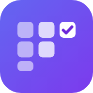
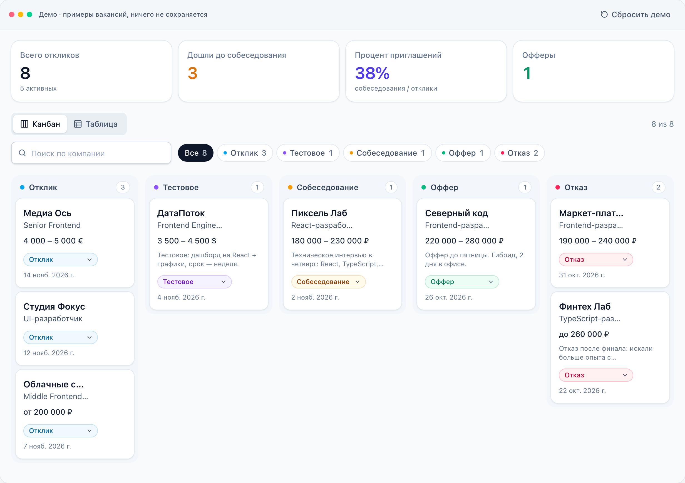
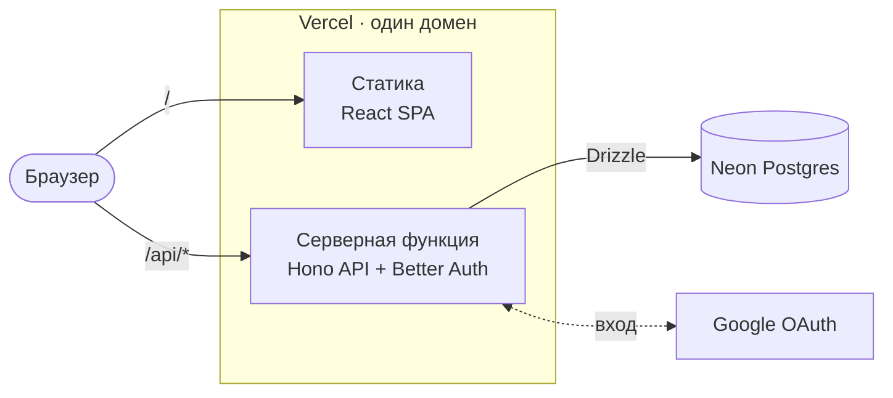

<div align="center">



# Трекер откликов на вакансии

Куда откликнулись, на каком этапе каждая вакансия и сколько откликов превращаются в собеседования — в одном месте.

**[job-tracker-olive-one.vercel.app](https://job-tracker-olive-one.vercel.app)** · живое демо прямо на стартовой странице, без регистрации

[](https://github.com/r12rv/job-tracker/actions/workflows/ci.yml)

</div>

<picture>
  <source media="(prefers-color-scheme: dark)" srcset="docs/images/tracker-dark.png" />
  
</picture>

## Возможности

- **Канбан с перетаскиванием** — мышью, пальцем на телефоне или с клавиатуры. Статус и порядок карточек сохраняются на сервере.
- **Таблица, поиск и фильтры** по компании и статусу.
- **Статистика воронки** — сколько откликов дошли до собеседования и до оффера, процент приглашений.
- **Вход через Google** — вакансии хранятся в аккаунте и доступны с любого устройства.
- **Живое демо** на стартовой странице: настоящий интерфейс на примерах, можно потрогать до входа.
- **Светлая и тёмная темы**, мобильная вёрстка, доступность для клавиатуры и скринридеров.
- **Честная работа со сбоями** — если сервер не ответил, изменение откатывается, а в углу появляется уведомление с кнопкой «Повторить».

## Как сделан проект

Код написан с помощью [Claude Code](https://claude.com/claude-code). Я ставила задачи, принимала продуктовые решения, настраивала инфраструктуру, проверяла результат и одобряла каждое слияние. Ниже — что именно было на мне.

**Продукт**

- Задала требования, которых не было в первоначальном плане: стартовая страница с презентацией сервиса до входа, все функции — только после входа, перетаскивание карточек в канбане.
- Отказалась от переноса данных из локального хранилища браузера: после разбора оказалось, что он добавляет код и сценарии ошибок, но ничего не даёт пользователям нового сервиса.
- Уточнила, как пользователь узнаёт о сбое: изменение откатывается, в углу появляется уведомление с кнопкой «Повторить».
- Задала поведение стартового экрана: первый экран на всю высоту, по кнопке «Посмотреть демо» — плавная прокрутка к демо.

**Инфраструктура** (доступ к аккаунтам был только у меня)

- Настроила вход через Google в Google Cloud: OAuth-клиент, адреса возврата, тестовые пользователи, затем публикация приложения.
- Подключила Vercel и Neon, завела переменные окружения для продакшена и превью-деплоев.
- Сделала e2e-тесты обязательной проверкой: код не попадает в `main` без зелёных lint, тестов API и e2e.

**Что я заметила и проверила**

- **Ошибка 403 при входе на локальном сервере.** Дев-сервер молча занял соседний порт, которого нет в списке доверенных адресов авторизации. Исправили: сервер запускается только на своём порту и при конфликте сразу падает с понятной ошибкой.
- **Неверное утверждение ИИ.** Claude Code считал, что приложение Google ещё в тестовом режиме. Я сверила с консолью: оно уже опубликовано.
- **Пропущенный этап.** Заметила, что оптимизация размера бандла выпала из плана, и вернула её перед финальным этапом ([#13](https://github.com/r12rv/job-tracker/pull/13)).
- **Ручное тестирование продакшена** ([#14](https://github.com/r12rv/job-tracker/pull/14)):
  - стрелка в выпадающих списках прилипала к правому краю поля — у системной стрелки нельзя задать отступ, заменили своей;
  - интерфейс показался слишком ярким — добавили тёмную тему, которая следует за системой и переключается в шапке;
  - у сервиса не было лица — появился логотип во вкладке и в шапке.
- **Каждый этап проверяла сама:** превью-деплой, вход в продакшене, поведение API на превью.

**Вопросы, которые я задавала**

- Почему dnd-kit, а не другие библиотеки перетаскивания.
- Что именно покрывают e2e-тесты и в какой момент они запускаются.

## Стек

| | Технология | Почему |
|---|---|---|
| Фронтенд | React 19, TypeScript, Vite, Tailwind CSS 4 | Строгий TypeScript без `any`, быстрая сборка, стили рядом с разметкой |
| Данные на клиенте | TanStack Query | Кэш, оптимистичные обновления с откатом, повтор только сетевых сбоев |
| Перетаскивание | dnd-kit | Мышь, тач и клавиатура из коробки, озвучка для скринридеров, небольшой размер |
| API | Hono + Hono RPC | Типы запросов и ответов выводятся из кода сервера — фронтенд не может разойтись с API |
| Валидация | Zod — общий пакет для фронтенда и API | Одна схема проверяет и форму, и запрос на сервере |
| База | Postgres (Neon) + Drizzle ORM | SQL-миграции в репозитории, у каждого превью своя ветка базы |
| Авторизация | Better Auth + Google OAuth | Сессии и пользователи в нашей базе, httpOnly-cookie, работает на превью-деплоях |
| Тесты | Vitest, Playwright, axe-core | Тесты API на настоящем Postgres, e2e в браузере, проверка доступности |
| Деплой | Vercel, GitHub Actions | Превью на каждый PR, продакшен после слияния |

## Архитектура



Фронтенд и API на одном домене, поэтому cookie сессии работают без CORS. Монорепозиторий на npm workspaces: `apps/web`, `apps/api`, общий пакет `packages/shared` и `e2e`.

Подробно — API, авторизация, алгоритм порядка карточек, деплой, устройство тестов: **[docs/ARCHITECTURE.md](docs/ARCHITECTURE.md)**.

## Ключевые решения

- **Один источник правды о данных.** Zod-схемы в `packages/shared` дают типы TypeScript и проверяют ввод и в форме, и в API. Hono RPC выводит типы запросов из кода сервера: поменяли маршрут — TypeScript подсветит фронтенд.
- **Оптимистичные обновления с честным откатом.** Смена статуса, перетаскивание и удаление применяются сразу. Если сервер не ответил, откатывается только затронутая карточка, и пользователь видит, что произошло, с кнопкой «Повторить».
- **Порядок карточек на дробных рангах.** Перетаскивание меняет в базе одну строку, а не всю колонку. Одновременные перетаскивания из разных вкладок не перемешивают порядок: строки блокируются в транзакции в фиксированном порядке, а устаревшее перемещение получает `409`.
- **Миграции при сборке.** На Vercel миграции применяются до сборки: если миграция не прошла, деплой не состоится. У каждого превью своя ветка базы, поэтому миграции из PR не трогают продакшен.
- **Вход в e2e без Google и без «чёрных ходов».** Тесты создают пользователя и подписанную сессию прямо в тестовой базе через настоящий Better Auth. В продакшен-API нет ни одного тестового маршрута.
- **Бандл под гостя.** Трекер загружается лениво, Zod и клиент API не попадают на стартовую страницу: 158 → ≈130 КБ gzip при первой загрузке.

## Качество

- **36 интеграционных тестов API** на настоящем Postgres: маршруты, валидация, права доступа, порядок карточек, гонки.
- **34 e2e-сценария** в Chromium: гость и демо, весь трекер, перетаскивание мышью и с клавиатуры, сбои сервера, мобильная вёрстка, переключение темы.
- **Доступность**: axe-core проверяет стартовую страницу, канбан, таблицу и форму в обеих темах на соответствие WCAG 2.1 AA.
- **Строгий линтер**: ESLint strict + type-checked, `any` запрещён.
- **Обязательные проверки** перед слиянием в `main`: lint и типы, тесты API, e2e.

E2E нашли настоящие баги ([#12](https://github.com/r12rv/job-tracker/pull/12)):

- форма принимала ссылку с пробелом, а сервер её отклонял — Chromium разбирает адреса мягче, чем Node, и тесты API этого не видели;
- первое нажатие стрелки при перетаскивании с клавиатуры не сдвигало карточку;
- брошенная на пустое место колонки карточка иногда вставала не туда;
- скринридер одинаково озвучивал каждый шаг перестановки;
- бледный текст не проходил по контрасту, а карточки были «кнопками с кнопками внутри».

## Процесс

Один этап — один pull request с описанием решений, слияние только после зелёного CI и моего одобрения.

| PR | Этап |
|---|---|
| [#1](https://github.com/r12rv/job-tracker/pull/1) | CI и Dependabot |
| [#5](https://github.com/r12rv/job-tracker/pull/5) | Монорепозиторий и общие Zod-схемы |
| [#6](https://github.com/r12rv/job-tracker/pull/6) | Postgres, миграции Drizzle и API вакансий |
| [#7](https://github.com/r12rv/job-tracker/pull/7) | Деплой API на Vercel с Neon |
| [#8](https://github.com/r12rv/job-tracker/pull/8) | Вход через Google, у каждого пользователя свои вакансии |
| [#9](https://github.com/r12rv/job-tracker/pull/9) | Фронтенд на API, вход обязателен |
| [#10](https://github.com/r12rv/job-tracker/pull/10) | Стартовая страница с живым демо |
| [#11](https://github.com/r12rv/job-tracker/pull/11) | Перетаскивание в канбане с сохранением порядка |
| [#12](https://github.com/r12rv/job-tracker/pull/12) | E2E-тесты и исправления того, что они нашли |
| [#13](https://github.com/r12rv/job-tracker/pull/13) | Дробление бандла |
| [#14](https://github.com/r12rv/job-tracker/pull/14) | Тёмная тема, логотип, правки по ручному тестированию |

## Локальный запуск

Нужны Node.js 22.12+ (версия закреплена в `.nvmrc`) и Docker.

```bash
nvm use
npm install
cp apps/api/.env.example apps/api/.env   # впишите секрет и ключи Google
npm run db:up        # Postgres в Docker (localhost:5433)
npm run db:migrate   # применить миграции
npm run dev          # приложение: http://localhost:5173
npm run dev:api      # API:        http://localhost:3001/api/health
```

Для входа через Google локально нужен OAuth-клиент в Google Cloud Console с адресом возврата `http://localhost:5173/api/auth/callback/google`.

<details>
<summary>Остальные команды</summary>

Запускаются из корня репозитория:

- `npm run build` — проверка типов и сборка фронтенда
- `npm run typecheck` — проверка типов во всех пакетах
- `npm run lint` / `npm run lint:fix` — ESLint по всему монорепозиторию
- `npm test` — тесты API на настоящем Postgres (база `job_tracker_test`)
- `npm run e2e` — e2e-тесты в браузере; `npm run e2e:ui` — то же в окне, где видно каждый шаг. Перед первым запуском: `npx playwright install chromium`
- `npm run db:generate` — создать миграцию после изменения схемы в `apps/api/src/db/schema.ts`
- `npm run db:studio` — Drizzle Studio, просмотр данных в браузере
- `npm run db:down` — остановить Postgres (данные сохраняются в Docker volume)

</details>
