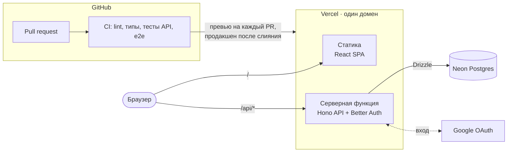

# Архитектура

Подробности для тех, кто хочет разобраться в устройстве проекта. Обзор — в [README](../README.md).

- [Схема](#схема)
- [Структура репозитория](#структура-репозитория)
- [API](#api)
- [Авторизация](#авторизация)
- [Данные на клиенте](#данные-на-клиенте)
- [Порядок карточек в канбане](#порядок-карточек-в-канбане)
- [Статистика](#статистика)
- [Тёмная тема](#тёмная-тема)
- [Размер бандла](#размер-бандла)
- [Деплой](#деплой)
- [Тесты](#тесты)
- [CI и защита ветки](#ci-и-защита-ветки)

## Схема



Фронтенд и API живут на одном домене: `/api/*` уходит в серверную функцию, остальное — статика. Поэтому cookie сессии работают без CORS и сторонних cookie, а фронтенду не нужен адрес API.

## Структура репозитория

Монорепозиторий на npm workspaces:

```
apps/web         — фронтенд (React + Vite + Tailwind)
apps/api         — API (Hono + Drizzle + Postgres)
packages/shared  — общие Zod-схемы, типы и функции рангов
e2e              — e2e-тесты (Playwright)
scripts          — сборка под Vercel
docs             — эта документация и скриншоты
```

**`packages/shared`** — единый источник правды о данных. Из Zod-схем выводятся типы TypeScript, а строгая схема ввода `vacancyInputSchema` проверяет и форму на фронтенде, и запросы в API. Справочники статусов и валют лежат отдельно в `constants.ts`, без Zod (зачем — в разделе [Размер бандла](#размер-бандла)).

**`apps/web/src`**

| Папка | Что внутри |
|---|---|
| `App.tsx` | Выбирает экран по сессии: загрузка, нет связи с сервером, гость, вошёл |
| `pages` | Стартовая страница и трекер (трекер загружается лениво) |
| `api` | `client.ts` — типизированный клиент Hono RPC; `errors.ts` — `ApiError` и тексты ошибок для уведомлений |
| `hooks` | `useVacancies` (данные и мутации через TanStack Query), `useFilteredVacancies`, `useStats`, `useLocalStorage` |
| `lib` | Клиент Better Auth, общий `QueryClient`, тема (`theme.ts`) |
| `components/tracker` | `TrackerBoard` — интерфейс трекера без привязки к данным: его используют и рабочая страница, и живое демо |
| `components/kanban` | Канбан с перетаскиванием на dnd-kit |
| `components/landing`, `demo` | Живое демо на стартовой странице и примеры вакансий для него |
| `components/*` | Остальной UI по разделам: `auth`, `table`, `stats`, `filters`, `vacancy`, `views`, `ui`, `layout` |
| `utils` | Форматирование, валидация формы через общую схему, `applyMove` — перемещение карточки по той же логике, что на сервере |
| `constants` | Подписи и цвета статусов |

`apps/web/brand/logo.svg` — исходник логотипа; PNG для вкладки, шапки и iOS лежат в `public`.

**`apps/api`**

| Файл / папка | Что внутри |
|---|---|
| `src/app.ts` | Приложение Hono без привязки к рантайму: зависимости передаются снаружи, поэтому его легко тестировать |
| `src/index.ts`, `src/vercel.ts` | Запуск на Node локально и точка входа серверной функции на Vercel |
| `src/auth.ts` | Настройки Better Auth: Google, `oAuthProxy` для превью, адрес сайта для каждого окружения |
| `src/db` | Схема Drizzle (включая таблицы Better Auth), подключение, миграции. SQL-миграции — в `drizzle/` |
| `src/vacancies` | Репозиторий (работа с базой) и маршруты |
| `test` | Интеграционные тесты через `app.request()` на настоящем Postgres |

## API

Все маршруты `/api/vacancies` требуют входа (иначе `401`) и работают только с вакансиями текущего пользователя: чужая вакансия неотличима от несуществующей — `404`.

| Метод | Путь | Описание |
|---|---|---|
| `GET` | `/api/health` | Проверка работоспособности и связи с базой (без входа) |
| `GET` / `POST` | `/api/auth/*` | Better Auth: вход через Google, callback, выход, `get-session` |
| `GET` | `/api/vacancies` | Список вакансий (новые отклики первыми) |
| `GET` | `/api/vacancies/:id` | Вакансия по id |
| `POST` | `/api/vacancies` | Создать вакансию |
| `PUT` | `/api/vacancies/:id` | Обновить вакансию целиком |
| `PATCH` | `/api/vacancies/:id/status` | Сменить статус (карточка встаёт наверх новой колонки) |
| `PATCH` | `/api/vacancies/:id/move` | Перетаскивание: `{ status, afterId }` — колонка и карточка, после которой встать; `409`, если соседа там уже нет |
| `DELETE` | `/api/vacancies/:id` | Удалить вакансию вместе с историей |

Тело запросов проверяется той же схемой, что и форма на фронтенде. Ошибка валидации — `400 { error: "validation_error", issues: [{ path, message }] }`. Каждая смена статуса записывается в отдельную таблицу `vacancy_status_changes`.

Фронтенд обращается к API через Hono RPC (`hc<AppType>`): пути, тела запросов и типы ответов выводятся из кода сервера. Поменяли маршрут на бэкенде — TypeScript подсветит фронтенд.

## Авторизация

[Better Auth](https://www.better-auth.com) + Google OAuth. Сессии хранятся в httpOnly-cookie, таблицы `user`, `session`, `account`, `verification` — в нашей базе, в тех же миграциях Drizzle.

- **Превью-деплои.** Google принимает только заранее зарегистрированные адреса возврата, а у каждого превью адрес новый. Плагин `oAuthProxy` проводит вход через продакшен-адрес и возвращает пользователя на превью уже с сессией. Доверенными считаются только превью этой команды Vercel.
- **Данные пользователя.** Вакансии принадлежат пользователю (`vacancies.user_id`, внешний ключ с каскадным удалением).
- **Истёкшая сессия.** Если API ответил `401`, глобальный обработчик TanStack Query просит Better Auth перечитать сессию, и приложение показывает стартовую страницу.
- **Сервер недоступен.** Это не то же самое, что «не вошли»: вместо кнопки входа показывается экран «Сервер недоступен» с повтором.

## Данные на клиенте

TanStack Query кэширует список вакансий. Смена статуса, перетаскивание и удаление — **оптимистичные**: интерфейс меняется сразу, а при ошибке сервера откатывается только затронутая карточка, и в углу появляется уведомление с кнопкой «Повторить». Создание и редактирование ждут ответа сервера: форма закрывается только после успеха, а при ошибке введённые данные остаются на месте.

Повторяются только сетевые сбои и ошибки `5xx` — ответ `4xx` от повтора не изменится.

## Порядок карточек в канбане

Порядок внутри колонки хранится в поле `rank` — дробном числе (fractional indexing). Карточка, вставленная между соседями, получает ранг посередине между их рангами, поэтому перетаскивание меняет в базе одну строку, а не всю колонку.

- **Перенумерация.** Когда точность заканчивается (≈50 вставок в одно место подряд) или ранги совпали, сервер перенумеровывает колонку.
- **Гонки.** Перемещение блокирует строки колонки в транзакции одним запросом в фиксированном порядке, поэтому одновременные перетаскивания из разных вкладок не перемешивают порядок и не вызывают взаимную блокировку.
- **Клиент передаёт соседа, а не ранг** (`afterId`). Если соседа уже нет на месте (карточку переместили на другом устройстве), сервер отвечает `409`, и клиент показывает актуальный порядок.
- **Одна логика на клиенте и сервере.** Функция `rankBetween` из `packages/shared` используется и для оптимистичного обновления в браузере.

Перетаскивание работает мышью, долгим нажатием на телефоне и с клавиатуры (пробел, стрелки, пробел). Для скринридеров каждое действие озвучивается по-русски: «место 2 из 3 в колонке «Отклик»».

## Статистика

«Дошли до собеседования» — вакансии, которые хотя бы раз были в статусе «Собеседование» или «Оффер» по истории статусов. Поэтому отказ после собеседования тоже учитывается, и процент приглашений не падает, когда вакансия уходит в «Отказ».

## Тёмная тема

- Пока пользователь не выбрал тему сам, она следует за настройкой системы и меняется вместе с ней.
- Выбор из переключателя в шапке хранится в `localStorage` и синхронизируется между вкладками.
- Короткий скрипт в `index.html` применяет тему до первой отрисовки, поэтому страница не мигает белым. Логика этого скрипта повторяет `src/lib/theme.ts`.
- `color-scheme` переключает и системные элементы: календарь, полосы прокрутки, выпадающие списки.
- Контраст проверяется axe в e2e-тестах для обеих тем.

## Размер бандла

| | Стартовая загрузка | После входа |
|---|---|---|
| Один бандл (до оптимизации) | 512 КБ (158 КБ gzip) | — |
| Сейчас | ≈410 КБ (≈130 КБ gzip) | + чанк трекера ≈105 КБ (≈32 КБ gzip) |

- **Трекер загружается лениво** (`React.lazy`): форма, клиент API и валидация не нужны гостю на стартовой странице.
- **Ошибки API отделены от клиента Hono.** Глобальный обработчик ошибок загружается сразу и иначе тянул бы за собой весь клиент.
- **Zod не попадает на стартовую страницу.** Справочники статусов вынесены в модуль без Zod, а пакет `shared` помечен `"sideEffects": false`. Без этого сборщик был обязан выполнить все `z.object(...)` из файла схем, даже если нужны только константы.
- **Библиотеки разнесены по отдельным файлам** (`react`, `dnd-kit`, `vendor`). Они меняются реже нашего кода, поэтому после релиза браузер скачивает заново только изменившиеся файлы.

Выигрыш для гостя умеренный: живое демо использует тот же канбан и dnd-kit, что и трекер.

## Деплой

Vercel + Neon (Postgres). Сборка идёт через [Build Output API](https://vercel.com/docs/build-output-api/v3) скриптом `scripts/build-vercel.ts` (`npm run build:vercel`):

1. На Vercel применяет миграции к базе окружения. У продакшена — основная база Neon, у каждого превью — своя ветка базы, поэтому миграции из PR не трогают продакшен. Если миграция не прошла, сборка падает и деплой не происходит.
2. Собирает фронтенд в `.vercel/output/static`.
3. Упаковывает API esbuild'ом в одну серверную функцию `.vercel/output/functions/api.func`.
4. Маршрутизирует `/api/*` в функцию, остальное — в статику.

Переменные окружения: `DATABASE_URL` и `DATABASE_URL_UNPOOLED` прописывает интеграция Neon; `BETTER_AUTH_SECRET`, `GOOGLE_CLIENT_ID`, `GOOGLE_CLIENT_SECRET` заданы вручную для Production и Preview. После изменения переменных нужен повторный деплой.

## Тесты

| Уровень | Чем | Сколько | Что проверяет |
|---|---|---|---|
| Интеграционные тесты API | Vitest + настоящий Postgres | 36 | Маршруты, валидацию, права доступа, порядок карточек, гонки, ограничения базы |
| E2E | Playwright + Chromium | 34 | Сценарии пользователя целиком: браузер → API → база |

**Как устроены e2e.** Тесты сами поднимают API на отдельной базе `job_tracker_e2e` и продакшен-сборку фронтенда на своих портах (3180 и 5180), поэтому не мешают `npm run dev`. Вход через Google в тестах не нужен: перед тестом в базе создаются пользователь и подписанная сессия (плагин Better Auth `testUtils`), а браузер получает готовую cookie. В продакшен-API никаких тестовых «чёрных ходов» нет.

**Сценарии:**

- **гость** — стартовая страница, живое демо (статусы, перетаскивание), переход на вход Google, переключение темы;
- **трекер** — добавление с проверкой ошибок формы, редактирование, удаление, статусы и статистика, поиск, фильтры, таблица, выход, изоляция данных разных пользователей;
- **канбан** — перетаскивание мышью между колонками, внутри колонки и в пустую колонку, с клавиатуры с озвучкой; порядок сохраняется после перезагрузки;
- **сбои** — подменённые ответы сервера: откат изменений, уведомления, «Повторить», экран «Сервер недоступен»;
- **телефон** — вёрстка без горизонтальной прокрутки, добавление и смена статуса (эмуляция Pixel 7);
- **доступность** — axe-core в светлой и тёмной темах на стартовой странице, в канбане, таблице и форме: без серьёзных нарушений WCAG 2.1 AA.

В CI при падении сохраняется HTML-отчёт Playwright с трейсами: пошаговые снимки экрана, сетевые запросы и консоль.

## CI и защита ветки

- Изменения попадают в `main` только через pull request; прямой push и force-push запрещены, история линейная.
- Обязательные проверки перед слиянием: **Lint, typecheck, build**, **API tests**, **E2E tests**. Ветка должна быть актуальна относительно `main`.
- CI также проверяет, что миграции соответствуют схеме: забытая миграция роняет сборку.
- Каждый PR получает превью-деплой на Vercel со своей веткой базы. После слияния продакшен обновляется автоматически.
- Dependabot предлагает обновления npm-зависимостей (еженедельно) и GitHub Actions (ежемесячно).
